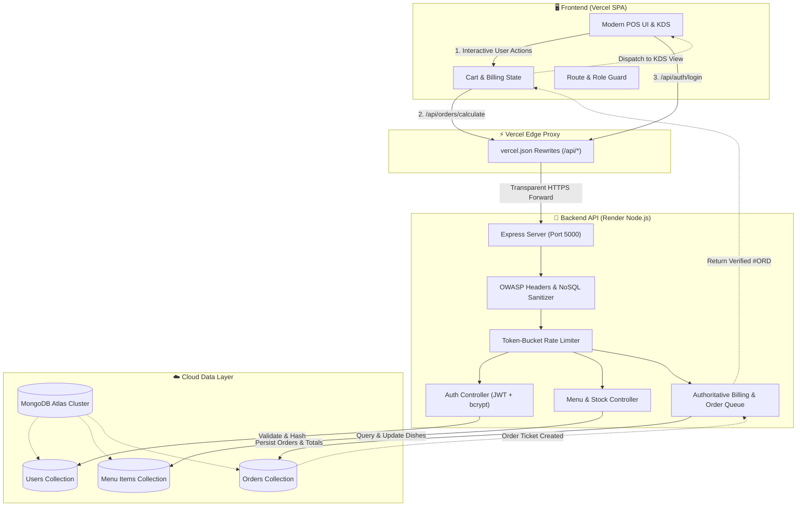
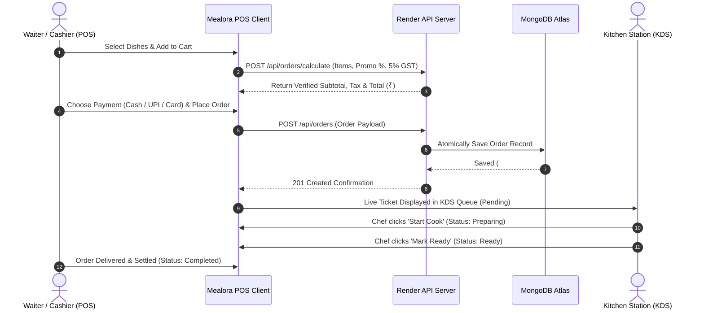

# 🍽️ Mealora — Restaurant POS & Kitchen Display Terminal

[](https://react.dev/)
[](https://vitejs.dev/)
[](https://tailwindcss.com/)
[](https://nodejs.org/)
[](https://www.mongodb.com/)
[](https://vercel.com/)

**Mealora** is a high-performance, full-stack Restaurant Management and Point-of-Sale (POS) system tailored for modern culinary venues. Built with **React 19**, **Vite**, **Express 5**, and **MongoDB Atlas**, it delivers sub-second order dispatching, server-authoritative billing, real-time Kitchen Display System (KDS) synchronization, and enterprise role-based security. Visit :- https://meal-ora-lac.vercel.app/

---

## 🔐 Demo Credentials

You can test both user roles directly from the login page or using the credentials below:

| Role | Email | Password | Access Level |
| :--- | :--- | :--- | :--- |
| **👑 Original Owner / Admin** | `admin@mealora.com` | `admin123` | **Full Authority**: Add/manage staff & admins, dish catalog, stock status, financial analytics, kitchen KDS & POS. |
| **👤 Demo Guest / Staff** | `John@gmail.com` | `123456` | **Staff Terminal**: Order placement, table & takeaway checkout, payment settlement, KDS ticket queue. *(Restricted from Admin menu & Team settings)* |

> [!IMPORTANT]
> **Administrative Security Notice:**  
> The original Admin account (`admin@mealora.com`) is permanently seeded into the database. **Only the original Admin possesses the permissions to create new staff accounts or assign additional administrators.** Any staff user attempting to bypass the UI and access administrative routes (`/admin`) is automatically intercepted and redirected to `/POS` by active authentication route guards.

---

## 🔄 System Architecture & Workflow

Below is the complete end-to-end data flow and architectural lifecycle of the Mealora platform:



---

## 🍳 Order Lifecycle Workflow



---

## ✨ Key Features & Capabilities

### 1. ⚡ High-Velocity POS Terminal
* **Fast Category Filtering:** Instant switching across Burgers, Mains, Sides, Desserts, and Drinks.
* **Instant Stock Verification:** Visual badges indicate out-of-stock items; cart automatically detects and blocks submission if unavailable items are chosen.
* **Flexible Order Modes:** One-click toggle between **Dine-In** and **Takeaway** workflows with table and customer tracking.

### 2. 🛡️ Server-Authoritative Billing Engine
* **Zero Client Calculation Vulnerabilities:** Disallow client-side tampering of discounts or taxes. All subtotal calculations, 5% GST, and promo discounts are computed and signed by the backend.
* **Dual Calculation Validation:** Optimistic instant local updates paired with debounced server verifications.
* **Indian Rupee (₹) Standardization:** Native currency localization with `en-IN` numeric formatting across cards, tables, receipts, and invoices.

### 3. 👨‍🍳 Kitchen Display System (KDS)
* **Real-time Ticket Tracking:** Cook stations view upcoming tickets with priority order numbers, special notes, and item quantities.
* **Ticket Status Pipeline:** Smooth progression through **Pending** $\rightarrow$ **Preparing** $\rightarrow$ **Ready** $\rightarrow$ **Completed**.
* **Clean Queue Indicators:** Automatically displays celebratory queue-cleared state when tickets are resolved.

### 4. 📊 Executive Analytics & Metrics
* **Key Performance Indicators:** Daily Gross Sales Revenue (₹), Total Shift Orders, Completed Ticket Count, and Active Kitchen Orders.
* **Channel Distribution:** Visual breakdown of Dine-In vs. Takeaway volume and settlement methods (Cash, UPI, Credit Cards).
* **Top Selling Dishes:** Automatic ranking of top culinary performers by order volume and revenue generation.

### 5. 🍽️ Admin Menu Management
* **Catalog Control:** Add new dishes, adjust prices in Rupees (₹), configure prep times, and write descriptions.
* **Instant Stock Toggle:** One-click stock switch immediately updates the POS grid across all active terminals.
* **Image Management:** Upload dish photos directly or link cloud-hosted high-resolution URLs.

### 6. 👥 Team & Staff Governance (Admin-Only)
* **Role-Based Access Control (RBAC):** Distinction between **Admin** and **Staff** permissions.
* **Staff Member Directory:** View active accounts, creation dates, and role tags.
* **Direct Account Creation:** Pre-hash passwords via salted bcrypt before persisting into MongoDB Atlas.

---

## 🛠️ Technology Stack

| Layer | Technologies Used |
| :--- | :--- |
| **Frontend Framework** | **React 19**, **Vite 8**, JavaScript (ESM) |
| **Styling & Design** | **Tailwind CSS v4**, Lucide React Icons, Custom Warm Luxury Dining Theme |
| **State & Navigation** | Pure React Hooks (`useMemo`, `useCallback`, `useState`, `useEffect`), Custom URL Route Guard |
| **Backend API** | **Node.js (v24)**, **Express 5**, RESTful architecture |
| **Database** | **MongoDB Atlas** via **Mongoose 9** ODM |
| **Security & Auth** | JSON Web Tokens (**JWT**), **bcryptjs** (10 salt rounds), OWASP Helmet Headers, In-memory Rate Limiting, NoSQL Sanitization |
| **Cloud Hosting** | **Vercel** (Frontend SPA + API Rewrites) + **Render** (Express Web Service) |

---

## 🚀 Local Development Setup

Follow these steps to run Mealora locally on your machine:

### 1. Clone the Repository
```bash
git clone https://github.com/rohitgupta7327/MealOra.git
cd MealOra
```

### 2. Install Dependencies
```bash
npm install
```

### 3. Configure Environment Variables
Create a `.env` file in the root directory (you can copy `.env.example`):
```env
PORT=5000
MONGODB_URI=your_mongodb_connection_string
JWT_SECRET=your_super_secret_jwt_key
JWT_EXPIRES_IN=7d
```

### 4. Start Development Servers
Runs both the **Backend API** (port 5000) and **Vite Frontend** (port 5173) concurrently:
```bash
npm run dev
```

* **Frontend:** Open [http://localhost:5173](http://localhost:5173) in your browser.
* **Backend Healthcheck:** Open [http://localhost:5000/api/health](http://localhost:5000/api/health).

---

## 📡 API Reference Overview

| Method | Endpoint | Access | Description |
| :--- | :--- | :--- | :--- |
| `POST` | `/api/auth/login` | Public | Authenticates credentials and issues signed JWT |
| `GET` | `/api/auth/me` | Authenticated | Fetches current user session profile & role |
| `GET` | `/api/auth/members` | **Admin Only** | Lists all team staff and administrator accounts |
| `POST` | `/api/auth/members` | **Admin Only** | Creates new staff or admin user in MongoDB |
| `GET` | `/api/menu` | Public | Retrieves culinary menu dishes from database |
| `POST` | `/api/menu` | **Admin Only** | Adds a new dish (supports image upload) |
| `PATCH` | `/api/menu/:id/stock`| **Admin Only** | Toggles dish availability status |
| `DELETE`| `/api/menu/:id` | **Admin Only** | Deletes a dish from catalog |
| `POST` | `/api/orders/calculate` | Public | Computes verified subtotals, tax, and discount |
| `POST` | `/api/orders` | Authenticated | Submits new verified POS order |
| `PATCH` | `/api/orders/:id/status`| Authenticated | Updates KDS status (Preparing / Ready / Completed) |
| `GET` | `/api/health` | Public | System status, database connection, security health |

---

## 👨‍💻 Author & Credits

Designed, architected, and built by **Rohit**.

* **Repository:** [https://github.com/rohitgupta7327/MealOra](https://github.com/rohitgupta7327/MealOra)
* **License:** Copyright © 2026 Mealora. All rights reserved.
